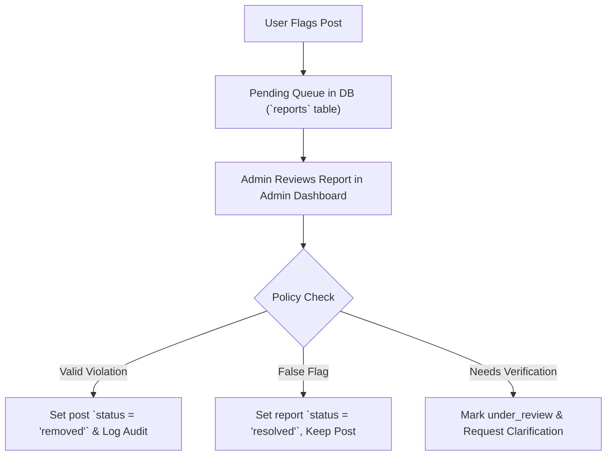

# Axom One - Administrator Moderation & Content Safety Guide

This document outlines the operational procedures, moderation standards, and enforcement protocols for moderators and administrators maintaining the **Axom One** platform.

---

## 1. Core Principles

Axom One serves as a cultural and community hub for Assam. Our moderation approach balances open regional expression with safety, cultural respect, and legal compliance.

- **Cultural Respect**: Foster celebration and preservation of indigenous crafts, languages (Assamese, Bodo, Bengali, English, and tribal dialects), festivals, and local traditions.
- **Accuracy & Fact-Checking**: Prevent the spread of sensationalized rumors, fake emergency notices, or unverified civic advisories.
- **Zero Tolerance for Hate & Harassment**: No content targeting communities, ethnic groups, religions, or individuals.
- **Transparency**: Every moderation action is recorded in the `moderation_logs` audit table with timestamp, moderator handle, and rationale.

---

## 2. Content Classification & Action Matrix

| Severity Tier | Violation Examples | Immediate Action | Secondary Action |
| :--- | :--- | :--- | :--- |
| **Tier 1 (Notice/Spam)** | Off-topic commercial advertising, repetitive identical posts, broken links | Flag & hide from main feed | Contact author; dismiss after edit or purge after 7 days |
| **Tier 2 (Misinformation)** | Fabricated civic closure notices, false flood/wildlife alerts | Instant takedown (`status = 'removed'`) | Issue warning to submitter IP/account |
| **Tier 3 (Harm/Hate)** | Communal incitement, harassment, unauthorized doxxing/PII leak | Hard removal & IP blacklist | Refer to legal/security team if safety threat |

---

## 3. Moderation Workflow



### Steps for Moderators:
1. **Access the Dashboard**: Open `/` and click the **🛡️ Moderation** tab in the navigation bar.
2. **Review Context**: Inspect the flagged post, the reason provided by the reporting user, and any contextual notes.
3. **Check Authenticity**: For wildlife or event announcements, check verified district administration or park authority channels (e.g., Kaziranga DFO, District Administration notices).
4. **Execute Action**:
   - **Dismiss Report**: Click `Dismiss Report` if the report was a false alarm or spam flag.
   - **Remove Post**: Click `Remove Post` if it violates Tier 1, 2, or 3 guidelines.

---

## 4. Vernacular Content Moderation Guidelines

Content on Axom One is frequently submitted in Eastern Indic script (অসমীয়া) or Latin transliteration. Moderators should ensure:
- Appropriate cultural context for terms related to festivals (Bihu, Raas, Me-Dam-Me-Phi, Ali-Aye-Ligang).
- Identification of local slang or slurs that may not be flagged by standard English profanity filters.
- Equitable representation across all districts of the Brahmaputra and Barak valleys.

---

## 5. Escalation & Audit Trail

All actions taken in the moderation tab execute the API endpoint `POST /api/moderation/action`, automatically persisting to the `moderation_logs` table:

```sql
INSERT INTO moderation_logs (id, post_id, action, reason, moderator, created_at)
VALUES (?, ?, ?, ?, ?, ?);
```

For platform integrity queries, contact: `admin-safety@axomone.org`
