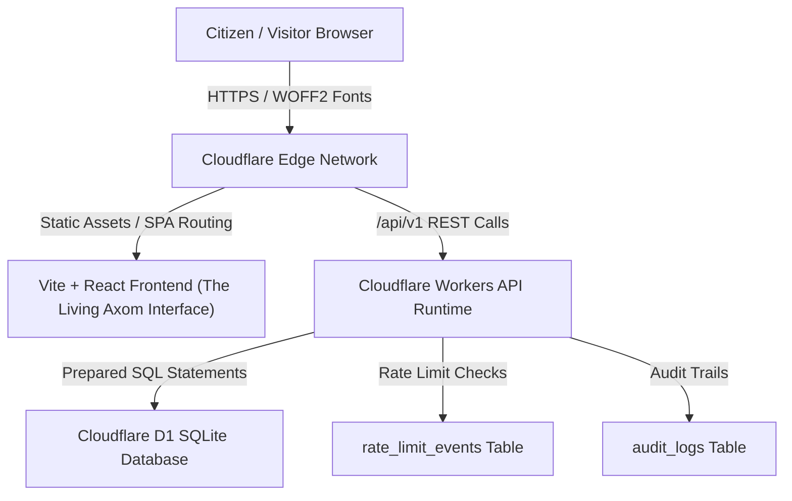

# AXOM ONE — System Architecture & Component Design

## 1. Architectural Topology

AXOM ONE is structured as a modern, high-performance edge application leveraging Cloudflare's serverless edge network and distributed storage:

---

## 2. Component Hierarchy (Frontend)

- **App Root** (`src/App.tsx`): React Router v7 configuration, top-level state provider for districts and active district filter.
  - **Public Layout** (`src/components/Header.tsx` & `src/components/Footer.tsx`):
    - District Selector with bilingual metadata (`name` + `name_as`).
    - Gamusa woven jacquard top strip.
    - Public disclaimer notice and navigation drawer for mobile screens.
  - **Public Views**:
    - `HomePage`: Hero banner, category grid, business spotlights, upcoming events, student opportunities, community notices, and submission CTA.
    - `ExplorePage`: Full directory with multi-faceted search (Keyword, District, Category, Listing Type, Sorting).
    - `BusinessDetailPage` / `EventDetailPage`: Detailed view, opening hours, verified status, share controls, and report link.
    - `SubmitPage`: User submission portal with anti-bot honeypot and client-side validation.
    - `ReportPage`: Content moderation report trigger with listing prefill.
    - Legal pages: `AboutPage`, `PrivacyPage`, `TermsPage`, `ContactPage`, `NotFoundPage`.
  - **Admin Layout** (`src/components/AdminLayout.tsx`):
    - Session-authenticated shell with navigation sidebar.
    - `AdminDashboardPage`: Metrics and volume counts.
    - `AdminSubmissionsPage`: Pending queue with approve/reject actions.
    - `AdminListingsPage`: Verification toggle, status suspension, sponsored partner badges.
    - `AdminReportsPage`: Triage and resolution of community user reports.
    - `AdminAuditLogsPage`: Audit history of administrative actions.

---

## 3. Backend & API Boundaries (`worker/index.ts`)

- **Public Subsystem**:
  - Unauthenticated endpoints with strict database-backed rate limiting based on client IP.
  - Prepared statements only — untrusted strings are never concatenated.
  - Filtered SQL views where only `moderation_status = 'published'` is exposed.
- **Admin Subsystem**:
  - Protected behind `authenticateAdmin()` middleware.
  - Validates session tokens hashed via SHA-256 against the `sessions` table.
  - Validates `expires_at > NOW()` and `is_active = 1`.
  - Automatically writes an immutable record to `audit_logs` on state-changing operations.
