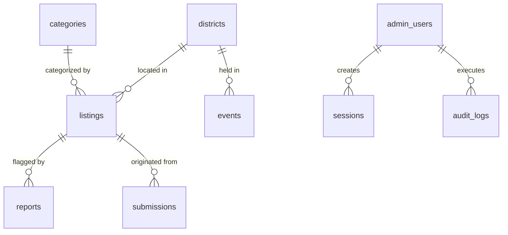

# AXOM ONE — Database Design & Migrations (Cloudflare D1)

## 1. Relational Schema Summary

The AXOM ONE database is implemented in **Cloudflare D1** (Serverless SQLite distributed across edge nodes).



---

## 2. Table Specifications

### `districts`
Represents all 35 recognized administrative districts of Assam.
- `id` (TEXT, PK): Unique identifier, e.g. `dist-kamrup-metro`.
- `name` (TEXT, NOT NULL): Official English district name.
- `slug` (TEXT, UNIQUE): URL-safe identifier, e.g. `kamrup-metropolitan`.
- `name_as` (TEXT, NOT NULL): Authentic Assamese Unicode name, e.g. `কামৰূপ মহানগৰ`.
- `is_active` (INTEGER): 1 = Active, 0 = Inactive.

### `categories`
- `id` (TEXT, PK): e.g. `cat-businesses`, `cat-crafts`.
- `name` (TEXT): Display name.
- `slug` (TEXT, UNIQUE): Category slug.
- `icon` (TEXT): Lucide React icon name.

### `listings`
Core directory entries for local businesses, services, tourism, and notices.
- `id` (TEXT, PK)
- `district_id` (TEXT, FK -> districts.id)
- `category_id` (TEXT, FK -> categories.id)
- `title` (TEXT, NOT NULL)
- `slug` (TEXT, UNIQUE)
- `description` (TEXT, NOT NULL)
- `listing_type` (TEXT): 'business', 'service', 'tourism', 'opportunity', 'community'.
- `verification_status` (TEXT): 'unverified' or 'verified'.
- `moderation_status` (TEXT): 'pending', 'published', 'rejected', 'suspended'.
- `is_sponsored` (INTEGER): 1 = Sponsored featured partner, 0 = Standard.
- `published_at` (TEXT, ISO-8601 UTC)

### `submissions`
Pending queue submissions from the public.
- `id` (TEXT, PK)
- `listing_id` (TEXT, Nullable, FK -> listings.id)
- `submitter_name` (TEXT)
- `submitter_email` (TEXT): Kept private for moderation follow-up.
- `submission_type` (TEXT)
- `payload_json` (TEXT): Serialized submission metadata.
- `moderation_status` (TEXT): 'pending', 'approved', 'rejected'.
- `reviewer_notes` (TEXT)

### `reports`
User feedback, fraud alerts, and inaccurate content reporting.
- `id` (TEXT, PK)
- `listing_id` (TEXT, FK -> listings.id ON DELETE CASCADE)
- `reason` (TEXT)
- `description` (TEXT)
- `reporter_contact` (TEXT, Nullable)
- `status` (TEXT): 'pending', 'resolved', 'dismissed'.

### `admin_users` & `sessions`
Secure credential and session storage.
- Passwords stored as PBKDF2 with 100,000 SHA-256 iterations and random cryptographic salt.
- Session tokens stored as SHA-256 digests in `sessions.token_hash`.

### `rate_limit_events`
Database-backed serverless rate limiting.
- `action_key` (TEXT): e.g. `login:192.168.1.1` or `sub:127.0.0.1`.
- `created_at` (TEXT): Timestamp used to compute rolling window thresholds.

---

## 3. Migration Commands

To execute migrations locally or remotely:

```bash
# Apply migrations locally
npm run db:migrate:local

# Apply migrations to Cloudflare Remote D1 instance
npm run db:migrate:remote

# Execute initial seed data
npm run db:seed:local
npm run db:seed:remote
```
